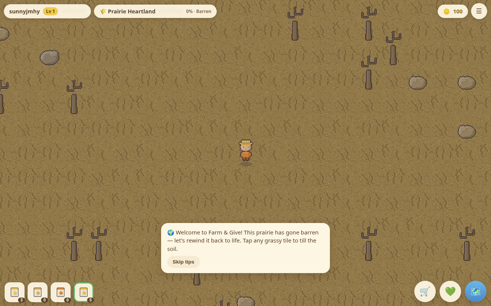
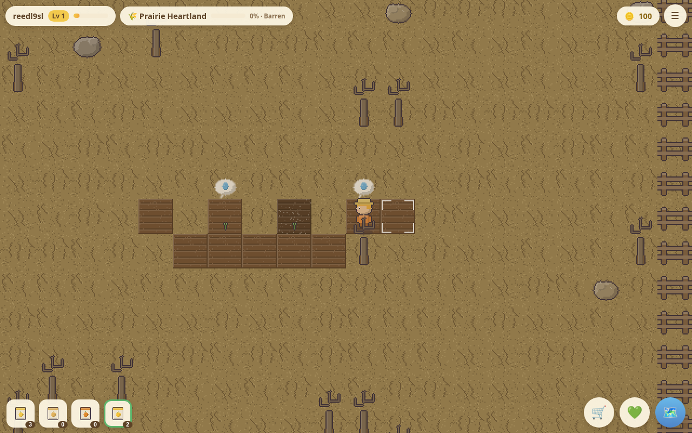
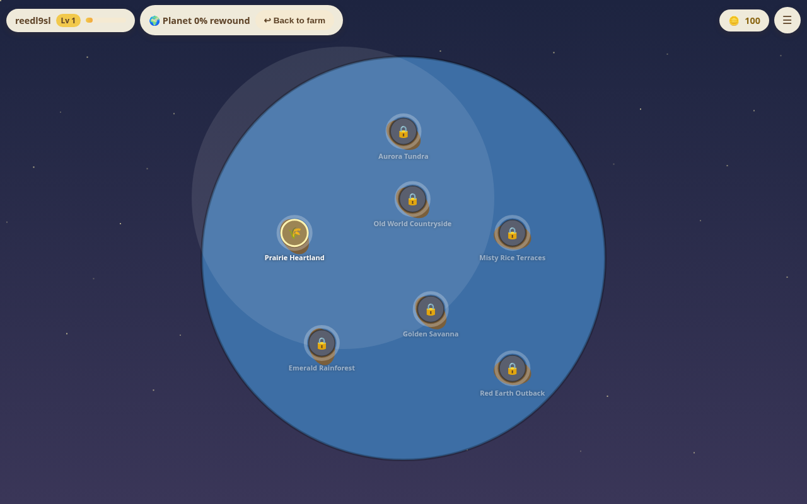
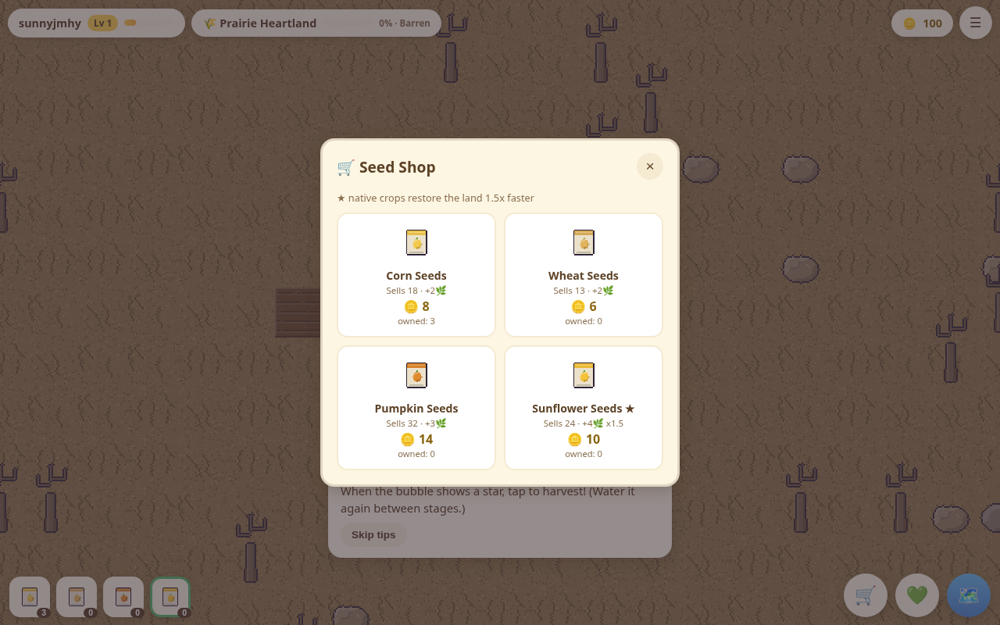
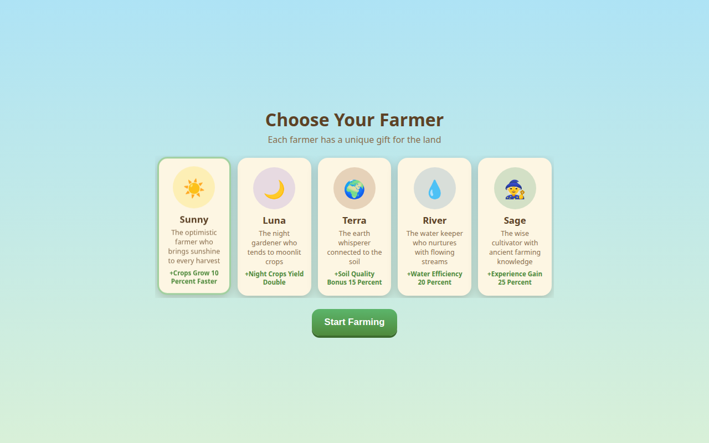

# Farm & Give

An earlier, playable iteration of **Cosmic Bloom**. This repository was developed as Farm & Give (package `farm-and-give`, native id `com.farmandgive.app`), formerly FarmandGiveGame. The game in this tree is the web and Capacitor client titled **Farm & Give — Rewind the Planet**.

A later branch, `claude/session-q6x9es`, starts a separate Unity design. This checkout is the web and Capacitor game, and this document describes that client and API.

Screenshots below are from a local run of that client.

## What it is

You register, choose one of five farmers, and start on a worn-down 30×30 prairie. Farming heals that region. As its restoration score rises, the ground, trees, and light change, and wildlife returns. At 50% you can spend coins to open the next region and travel there from a world map.

The charity screen lets a player pick a community garden. When a native in-app purchase is recorded, the server stores a share of that purchase price (10% unless `CHARITY_PERCENTAGE` is set) on the transaction and adds it to the chosen garden's `totalReceived`. Buying seeds spends in-game coins only.

## How it plays

Movement and farming are the same action. Tap a tile to walk there (pathfinding). If the tile has a farm action and the farmer is on it or next to it, the tap does that action; otherwise the farmer walks to a neighboring tile and then does it. Drag the canvas to pan. Arrow keys or WASD move directly. Space or Enter uses the tile the farmer is facing, or the tile under them.

On grass the action is contextual:

1. **Till** empty grass.
2. **Plant** the selected seed. Planting spends one seed from the inventory.
3. **Water** a thirsty crop. Watering starts that stage's timer.
4. **Harvest** when the crop reaches stage 4.

A crop has five drawn stages (0 through 4). Each watering advances one stage after `growMs` milliseconds (20–58 seconds in the current crop data). If the app is closed or the tab is hidden, a watered crop can still advance that one stage when you return. It needs water again before the next stage. The selected seed is the highlighted slot in the bottom bar.

You begin with 100 coins, 5 sunflower seeds, and 3 corn seeds, on Prairie Heartland. Tilling, planting, and watering grant 1, 2, and 1 XP. A harvest pays the crop's sell price and XP. The next level costs `level × 100` XP.

Each region has four crops. The one marked native restores 1.5× as much. Harvest restoration is that crop's `restore` value, times 1.5 when it is native. The score is capped at 100.

| Score | What changes |
| --- | --- |
| 25, 50, 75, 100 | Milestone coins: 60, 150, 300, 600 |
| 34 and 67 | Ground tier, tree sprite, and ambient tint step from barren to recovering to thriving |
| 40 and up | Wildlife appears. The count grows from 1 to 4. Tapping a creature plays a heart burst |
| 50 on the previous region | The next region can be unlocked if you also meet its coin and level cost |

| Region | Place | Native crop | Unlock |
| --- | --- | --- | --- |
| Prairie Heartland | North America | Sunflower | Open from the start |
| Old World Countryside | Europe | Grapes | 300 coins, level 3 |
| Misty Rice Terraces | Asia | Rice | 700 coins, level 5 |
| Golden Savanna | Africa | Sorghum | 1,200 coins, level 8 |
| Emerald Rainforest | South America | Cacao | 2,000 coins, level 11 |
| Red Earth Outback | Australia | Quandong | 3,200 coins, level 14 |
| Aurora Tundra | The Arctic | Cloudberry | 5,000 coins, level 17 |

Terraces, rainforest, and tundra maps also include a small pond. Every map has a fence border, a clear center, and seeded trees, rocks, and a biome prop. The same farm seed rebuilds the same map.

Farmer effects implemented in the farm code:

- **Sunny** — stage timers are 90% of the crop's `growMs`.
- **Luna** — harvest coins are doubled when the device's local hour is 18–23 or 0–5.
- **Terra** — harvest coins are multiplied by 1.15, then floored.
- **River** — after watering, a 20% roll also waters each orthogonally adjacent thirsty crop.
- **Sage** — harvest XP is multiplied by 1.25, then floored.

The character cards show short bonus labels from the API. Luna, Terra, and River's labels are looser than the formulas above.

The seed shop sells the current region's crops for coins. A first-run coach card walks through till, plant, water, harvest, the shop, the map, and the charity screen. It can be skipped. The menu can save, toggle music and sound effects, log out, or delete the account (password required).

Coin packs exist only in the Capacitor app, and only when a RevenueCat key is present at build time. The server maps four product ids to coin grants: `fag_coins_pouch` (500), `fag_coins_chest` (1,500), `fag_coins_wagon` (4,000), and `fag_supporter_pack` (2,500). The webhook is the source of truth; the client claims pending coins from `/api/payments/sync`.

## Screenshots

Local Vite session after registering and choosing Sunny.











## Stack

| Layer | What this tree uses |
| --- | --- |
| Client | Vanilla JavaScript ES modules, HTML5 canvas, one CSS file. Vite 8 builds `client/` to `www/`. |
| Art | Generated pixel art. `npm run art` draws 434 frames into 8 atlases with `@napi-rs/canvas`. The atlases are committed. |
| Audio | WebAudio: synthesized effects and a procedural pentatonic loop per biome. |
| Native shell | Capacitor 8 projects in `ios/` and `android/`, plus haptics, preferences, network, splash, and status-bar plugins. |
| Purchases | `@revenuecat/purchases-capacitor` on device. The Express webhook records the grant. |
| API | Node.js, Express 4, Mongoose 7, JWT, bcrypt, Helmet, CORS, and rate limits. |
| Data | MongoDB. Models are User, Charity, and Transaction. |
| Tests | Vitest. Unit tests for biomes, farming, and restoration. API tests use Supertest and `mongodb-memory-server`. |
| CI | GitHub Actions installs with `PUPPETEER_SKIP_DOWNLOAD=true`, regenerates art and fails if atlases drift, then tests and builds the client. |

`.nvmrc` is `20`, which is what CI selects. Install, tests, and the client build were also run on Node.js 22.14.0.

## Architecture

```
client/                 Vite root
  index.html            Screens: loading, auth, farmers, game, shop, charity, map unlock, menu
  js/main.js            Boot, auth, then Game
  js/game.js            Fixed-timestep loop, scene changes, save timing
  js/scenes/farm.js     One region's world, crops, creatures, avatar
  js/scenes/worldmap.js Seven nodes and restoration rings
  js/data/biomes.mjs    Shared by the client and tools/art
  js/engine/            Input, atlases, audio, pathfinding, creatures, particles
  public/atlases/       PNG + JSON atlases
  public/legal/         Privacy and terms pages
server/app.js           Express app, imported by tests without listening
server/index.js         Loads .env, connects MongoDB, listens
server/routes/          /api/auth, /api/game, /api/charity, /api/payments
tools/art/              Deterministic sprite generator
ios/  android/          Capacitor projects (webDir: www)
```

In development, Vite serves the client on port 5173 and proxies `/api` to Express on port 5000. `npm start` serves `www/` when that build exists, and otherwise serves the `client/` directory.

Accounts are required for the first session: registration, login, and the farmer list all go through the API. After that, saves are written to local storage immediately (`fag_save_v2`). If a token is still stored and the API cannot be reached, the client continues from the local save. A server copy is pushed about once a minute and when the tab hides. If both copies use schema 2, the higher `saveVersion` wins.

Legacy schema-1 farm plots are converted into a prairie farm on load. New snapshots use schema 2.

## Setup

MongoDB has to be running. The API exits if it cannot connect.

```bash
PUPPETEER_SKIP_DOWNLOAD=true npm ci
cp .env.example .env
```

`.env.example` lists names only. Fill values in the untracked `.env`. Do not commit it.

| Name | Role |
| --- | --- |
| `MONGODB_URI` | Required. Server and `npm run seed` connect with this. |
| `JWT_SECRET` | Required for register, login, and authenticated routes. Tokens last 30 days. |
| `PORT` | API port. Defaults to 5000. |
| `NODE_ENV` | `development` enables request logging. |
| `CLIENT_URL` | Extra CORS origin for a deployed web client. Local Vite and Capacitor origins are already allowed. |
| `CHARITY_PERCENTAGE` | Share of a recorded purchase price. Defaults to 10. |
| `REVENUECAT_WEBHOOK_AUTH` | Full `Authorization` header value the webhook must match. |
| `VITE_API_URL` | Optional build-time API base. The dev client uses its own origin plus `/api`. |
| `VITE_REVENUECAT_KEY_IOS` | RevenueCat public SDK key for the iOS app. |
| `VITE_REVENUECAT_KEY_ANDROID` | RevenueCat public SDK key for the Android app. |

```bash
npm run seed     # 10 sample gardens from server/utils/seedData.js
npm run dev      # API on :5000 and Vite on :5173
```

Open [http://localhost:5173](http://localhost:5173). Register, pick a farmer, and tap grass to till.

Other scripts:

| Script | What it does |
| --- | --- |
| `npm start` | API only. Serves `www/` if the client has been built. |
| `npm test` | Vitest unit and API tests. |
| `npm run client:build` | Writes the production client to `www/`. |
| `npm run client:preview` | Serves the production build with Vite. |
| `npm run art` | Regenerates atlases, icon, and splash. Commit the result if output changes. |

`PUPPETEER_SKIP_DOWNLOAD=true` matches CI and `render.yaml`. Puppeteer is installed for the optional ACGA scrape scripts under `server/scripts/`. Playing and building do not need its browser download.

Atlas debug viewer, with the dev server running: [http://localhost:5173/debug/atlas-viewer.html](http://localhost:5173/debug/atlas-viewer.html).

`render.yaml` is a Render blueprint that builds the client and starts the API. Native iOS and Android shells are the Capacitor projects; this pass did not compile them.

## Contributors

From the git history of this repository:

- **Shay Bouchles** — merged the playable client (pull request #1).
- **shaythegay13** — initial Farm & Give commit.
- **Claude** — the Vite client, generated art, Capacitor projects, API work, and tests in this tree, plus the later Unity notes on `claude/session-q6x9es`.

## License

`package.json` declares MIT. This repository does not include a `LICENSE` file.

## Other documents

`API_DOCUMENTATION.md`, `ART_STYLE_GUIDE.md`, `QA_CHECKLIST.md`, and `STORE_SUBMISSION_CHECKLIST.md` sit next to the code they describe. `GAME_DESIGN.md`, `PROJECT_SUMMARY.md`, `QUICKSTART.md`, `SETUP.md`, and the Unity guides describe an earlier single-farm plan, including Stripe and other ideas from that draft. When they disagree with this file, the code and this README are the description of what runs.
